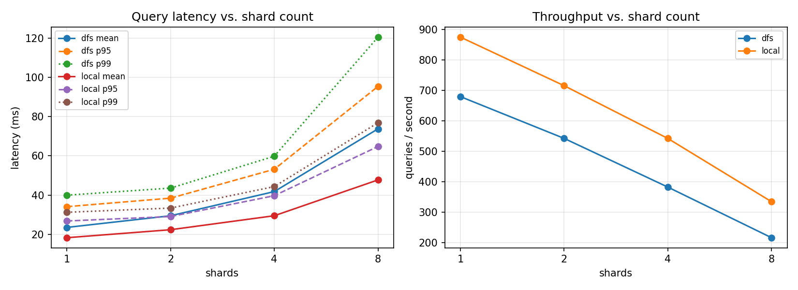
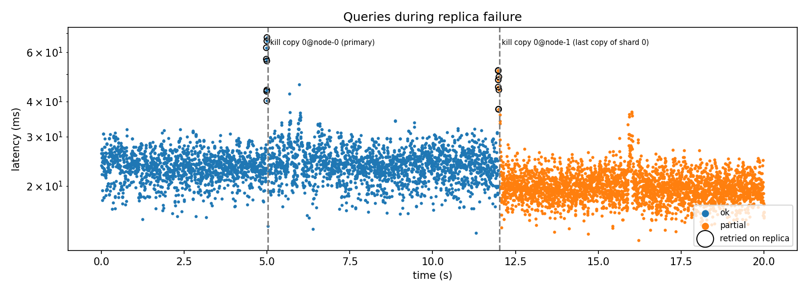

# Elasticsearch-Inspired Distributed Search Engine — Final Report

**Distributed Systems course project** · Sumit Kothalkar · Sowreddy Pranavi

## Abstract

We built a small distributed full-text search engine modelled on
Elasticsearch. Documents are hash-partitioned across N shards. Every shard
has a replica on a different node, and a coordinator answers queries by
scatter-gather, ranking with BM25 (and TF-IDF as a baseline). On about 120k
MS MARCO passages, distributed rankings that use corpus-wide statistics are
**identical to a single-node index on 100% of queries**. Shard-local
statistics change the top-10 for 85–94% of queries, and the drift grows
with the shard count. When a replica is killed under load, queries fail over
with no errors. When every copy of a shard is lost, responses carry an
explicit `partial: true` flag that names the missing shard. Nodes can leave
and join while queries are running: copies are re-replicated and rebalanced
in about 7 s with no failed queries. On one 4-core machine, throughput fell
from 1 to 8 shards. Splitting work this fine adds coordination cost, and
the processes compete for cores, which together outweigh the gain from
parallelism. Measuring the system also exposed a bug of our own: a
background statistics refresh that inflated p99 latency up to 5×.

## 1. Goals

The write-up set eight goals. This table shows where each one is addressed.

| # | Goal | Where |
|---|---|---|
| 1 | Sharded indexing by hash of document id, inverted index per shard | §2.1 |
| 2 | Scatter-gather with a heap merge of per-shard top-k | §2.2 |
| 3 | BM25 with global statistics; pre-query (DFS) vs. periodic refresh | §2.3, §4.1 |
| 4 | Replication and failover to a surviving copy | §2.4, §4.3 |
| 5 | Shard allocation (no two copies on one node) and rebalancing | §2.5, §4.4 |
| 6 | Ranking correctness: top-k overlap, Kendall's τ, NDCG@k | §4.1 |
| 7 | Mean/p50/p95/p99 latency and QPS for 1, 2, 4, 8 shards | §4.2 |
| 8 | Explicit failure semantics: full vs. flagged partial results | §4.3 |

## 2. Design

```
             client
               │  POST /search {query, k, scorer, stats_mode}
               ▼
        ┌─────────────┐   heartbeat (GET /health every 0.25–0.5 s)
        │ coordinator │──────────────────────────────────────┐
        └─────────────┘                                      │
   (1) DFS: POST /stats  ─┐   (2) POST /search {terms, k, global stats}
                          ▼                                  ▼
   node-0           node-1           node-2           node-3
  [S0 primary]     [S1 primary]     [S2 primary]     [S3 primary]
  [S1 replica]     [S0 replica]     [S3 replica]     [S2 replica]
```

Each shard copy runs as its own OS process: a FastAPI server holding one
inverted index. A *node* is a logical name. Killing a node kills every copy
it hosts, which is how a machine failure is simulated on one host.

### 2.1 Indexing

* **Analysis:** lowercase, alphanumeric tokenisation, an English stop-word
  list, and the NLTK Porter stemmer. The coordinator analyses the query once
  and sends terms, so index-time and query-time analysis are identical by
  construction.
* **Routing:** `shard = crc32(doc_id) mod N`. Python's built-in `hash` is
  salted per process, so we could not use it. Shards came out within 2
  documents of equal size (12,498–12,502 docs per shard for 50k docs).
* **Index:** a term → postings map (document ids and term frequencies), plus
  a document-length table. Postings are frozen into NumPy arrays on first
  use, so scoring a term is a few vectorised operations.

### 2.2 Query execution (scatter-gather)

1. The coordinator analyses the query and, in DFS mode, gathers statistics
   (§2.3).
2. It sends the query terms to **one healthy copy of every shard** in
   parallel. Replicas are chosen round-robin, which spreads load over both
   copies.
3. Each shard returns its local top-k, sorted by (−score, doc id).
4. The coordinator merges the per-shard lists with a k-way heap merge
   (`heapq.merge`) and keeps the first k.

Ties are broken by document id, and per-term scores are summed in a fixed
order. Given the same statistics, every node therefore computes
bit-identical scores. This is what makes exact comparison with the
single-node index meaningful.

### 2.3 Consistent ranking: where the statistics come from

BM25 (k1 = 1.2, b = 0.75, Lucene's non-negative IDF) needs N, the average
document length and each term's document frequency (df). The coordinator
supports three strategies, selectable per query:

| Mode | How N / avgdl / df are obtained | Cost | Accuracy |
|---|---|---|---|
| `dfs` | Before scoring, ask every shard for the query terms' df and sum them, like Elasticsearch's `dfs_query_then_fetch` | One extra round trip per query | Always exact |
| `periodic` | Pull all statistics from all shards every *T* seconds and reuse them | No extra round trip | Stale between refreshes |
| `local` | Each shard uses its own statistics (Elasticsearch's default `query_then_fetch`) | Cheapest | Rankings drift |

TF-IDF (log-scaled tf, smoothed IDF) is supported with the same three modes.

### 2.4 Replication, failure detection and failover

* Every shard has one replica (two copies in total) on a different node.
* **Writes** go through the coordinator. A document is routed by hash and
  written to the primary first, then to the replicas. A copy that misses a
  write is marked *stale*, and the heartbeat will not bring it back.
* **Failure detection** works two ways: a heartbeat (`GET /health`) marks
  copies up or down, and any failed or timed-out request marks its copy down
  at once. A query that hits a dead copy is **retried on the next copy
  within the same query**.
* **Partial results:** if no copy of a shard answers, the query still
  returns the other shards' hits with `status: "partial"`, `partial: true`
  and `shards: {total, successful, failed, missing: [...]}`. With
  `allow_partial: false`, the query fails with HTTP 503 instead. Results
  never silently come from fewer shards.

### 2.5 Shard allocation and rebalancing

* **Initial placement:** primaries are placed round-robin, then replicas go
  to the least-loaded node that does not already hold a copy of the same
  shard.
* **A node leaves:** its copies are dropped. If a primary was lost, a
  surviving replica is promoted. Missing copies are re-created on the
  least-loaded valid nodes by **peer recovery**: the new process copies the
  live index (including writes made after startup) from a healthy copy.
* **A node joins:** copies move from the most-loaded to the least-loaded
  nodes until loads differ by at most one, preferring to move replicas. New
  copies are added to the routing table *before* old ones are retired, so
  queries always have a live copy.

## 3. Implementation

Python 3.10+, about 1,500 lines in the `dse/` package, plus experiments and
tests. FastAPI and uvicorn serve the shards and the coordinator, asyncio
handles concurrency, NumPy does scoring, and NLTK provides the stemmer.
pandas, SciPy and Matplotlib are used for analysis. **27 automated tests**
cover the following, including end-to-end tests that start real processes:

* exact distributed/single-node equality for 1, 2, 4 and 8 shards and both
  scorers;
* drift under local statistics;
* the allocation invariants;
* failover, partial results, write replication, recovery and rebalancing.

**Deviations from the write-up:**

1. **Coordinator → shard calls use aiohttp, not httpx.** Profiling showed
   httpx's connection pool using about 90% of the coordinator's CPU, which
   capped a 4-shard fan-out at about 230 queries/s. aiohttp reached about
   2,100 queries/s on the same benchmark. The load generator uses aiohttp
   for the same reason.
2. **More than one coordinator can run** (like Elasticsearch's
   coordinating-only nodes). The scaling experiment used 2, so one Python
   process was not the only bottleneck.
3. **Shard processes use fixed ports below the OS ephemeral range.** Ports
   picked by `bind(0)` could be taken by an outgoing connection before the
   shard bound them, and cluster start-up then hung occasionally.

## 4. Experiments and results

**Setup.** All final runs were on a Kaggle CPU session (4 vCPUs, about 30 GB
RAM), using `parthplc/ms-marco-dataset`:

* **Documents:** the `finalpassage` column of `train.csv`, de-duplicated to
  119,930 passages.
* **Queries:** the first 200 real MS MARCO queries from `valid.csv`.

The notebook `notebooks/kaggle_cluster.ipynb` reproduces everything.
Result files are in `results/kaggle_final/`. A second complete run of the
notebook (`results/kaggle_repeat_run/`) reproduced them: the ranking table
was identical, throughput was within 2%, p99 latency was within 8%, and
failover and rebalancing behaved the same (re-replication took 6.3 s and
6.7 s, versus 6.9 s and 7.0 s).

### 4.1 Ranking correctness (goals 3 and 6)

**Method.**

1. 80% of the corpus (shuffled) is indexed into 4 or 8 shards.
2. Each of the 200 queries runs on the cluster and on a single-node index
   over the same documents, and the two top-10s are compared.
3. The remaining 20% is then indexed *live* through the coordinator, without
   refreshing the periodic statistics, and the comparison is repeated
   against a single-node index of all the documents.

Metrics: top-10 overlap, Kendall's τ over the union of the two lists, NDCG@10
(the reference ranking used as graded relevance), and the share of queries
whose top-10 is exactly identical.

**Results (BM25).** TF-IDF follows the same pattern; see
`results/kaggle_final/ranking_table.csv`.

| Strategy | Shards | Top-10 overlap | Kendall's τ | NDCG@10 | Identical top-10 |
|---|---|---|---|---|---|
| Global (DFS) | 4 | 1.000 | 1.000 | 1.000 | **100%** |
| Global (DFS) | 8 | 1.000 | 1.000 | 1.000 | **100%** |
| Periodic, fresh | 4 / 8 | 1.000 | 1.000 | 1.000 | **100%** |
| Shard-local | 4 | 0.947 | 0.856 | 0.982 | 15.0% |
| Shard-local | 8 | 0.915 | 0.777 | 0.965 | 6.5% |
| DFS after 20% new docs | 4 / 8 | 1.000 | 1.000 | 1.000 | **100%** |
| Periodic, stale (after 20% new docs) | 4 / 8 | 0.997 | 0.990 | 0.999 | 81.0% |
| Shard-local after 20% new docs | 8 | 0.912 | 0.780 | 0.965 | 6.0% |

**Findings.**

* **Global statistics reproduce the single-node ranking exactly**, scores
  included, for both scorers and both shard counts. This held after live
  writes too, when DFS was used.
* **Shard-local statistics cause real drift, and it grows with the shard
  count.** With 8 shards, only 6.5% of queries keep the exact single-node
  top-10, and Kendall's τ drops to 0.78. Smaller shards are less
  representative samples of the corpus, so their df and avgdl are further
  from the global values. NDCG stays high (0.965), so the top results are
  mostly the same documents in a different order.
* **TF-IDF drifts less than BM25** (overlap 0.941 vs. 0.915 at 8 shards).
  BM25 also depends on each shard's average document length, so it has one
  more statistic that can be wrong.
* **DFS vs. periodic is a trade-off between freshness and a round trip.**
  Periodic statistics were exact while fresh. After 20% new documents, top-10
  overlap stayed at 0.997, but 19% of queries (BM25) had a slightly different
  top-10 until the next refresh. DFS is always exact, but it costs 29–55%
  more latency (§4.2).
* **The stale-periodic rows are the same for 4 and 8 shards.** That is
  expected: every shard scores with the same cached global statistics, so
  the result does not depend on how the documents are split.

### 4.2 Performance scaling (goal 7)

**Method.** A closed-loop load generator ran with 16 concurrent clients:

* each run lasts 20 s after a 2 s warm-up;
* 2 coordinators and 1 replica per shard;
* every shard call gets an injected network delay of 1 ms plus exponential
  jitter (mean 2 ms).

Up to 16 shard processes, 2 coordinators and the load generator share the 4
cores.



| Shards | QPS (DFS / local) | Mean ms (DFS / local) | p95 ms (DFS / local) | p99 ms (DFS / local) |
|---|---|---|---|---|
| 1 | 680 / 875 | 23.5 / 18.3 | 34.1 / 26.8 | 40.0 / 31.2 |
| 2 | 543 / 716 | 29.5 / 22.4 | 38.4 / 29.1 | 43.6 / 33.4 |
| 4 | 383 / 543 | 41.8 / 29.5 | 53.2 / 39.7 | 59.8 / 44.3 |
| 8 | 217 / 335 | 73.8 / 47.7 | 95.4 / 64.8 | 120.5 / 76.9 |

No request failed in any configuration.

**Findings.**

* **Throughput fell as shards were added** (875 → 335 queries/s for local
  statistics, 680 → 217 for DFS). The write-up expected it to rise. Each
  query costs the coordinator S shard calls (2S with DFS), so coordination
  work grows linearly with the shard count. Meanwhile each shard's share of
  the scoring shrinks, and it was already small: scoring the whole 120k-passage
  index takes only a few milliseconds. On a 4-core machine, the extra processes also compete for the same
  cores. Sharding pays off when per-shard work dominates (much larger
  indexes) and when shards run on separate machines. Neither holds here.
* **The tail grows with the shard count.** p99 rises from 40 to 120 ms
  (DFS), and the gap between p99 and the median grows from 17 to 48 ms
  between 1 and 8 shards. A query finishes only when its *slowest* shard
  answers. With more shards, it is more likely that one of them is delayed
  by scheduling, garbage collection or injected jitter. The injected jitter
  alone explains only a few milliseconds: for exponential jitter with mean
  2 ms, the expected slowest of S shards is 2·H_S ms, which is 2.0 ms at
  S = 1 and 5.4 ms at S = 8. Most of the growth comes from CPU contention,
  which the scatter-gather pattern amplifies the same way.
* **DFS costs 29–55% more latency than local statistics,** and the overhead
  grows with the shard count, because its extra statistics round trip also
  waits for the slowest shard. That is the price of the exact rankings in
  §4.1.

**A bug that measurement exposed.** In the first Kaggle run
(`results/kaggle_before_refresh_fix/`), p99 reached 647 ms at 8 shards. The
slowest 1% of requests all fell in bursts about 5.4 s apart. That matched
the periodic refresh, which pulled all 161k terms' statistics from every
shard every 5 s — even when no query used periodic mode. After the fix
(refresh only once periodic statistics are in use), the tail looks like
this:

| p99 ms (DFS) | 1 shard | 2 | 4 | 8 |
|---|---|---|---|---|
| Before fix | 58.3 | 172.7 | 291.7 | 647.0 |
| After fix | 40.0 | 43.6 | 59.8 | 120.5 |

### 4.3 Failure demonstration (goals 4 and 8)

**Method.** 4 shards × 2 copies, 8 concurrent clients for 20 s, a per-call
timeout of 0.5 s and a 0.25 s heartbeat. At t = 5 s we SIGKILL the primary
of shard 0. At t = 12 s we SIGKILL its last copy.



| Phase | Requests | QPS | Errors | Partial | Mean ms | p99 ms | Retried |
|---|---|---|---|---|---|---|---|
| Both copies up (0–5 s) | 1,696 | 339 | 0 | 0% | 23.7 | 30.7 | 8* |
| One copy down (5–12 s) | 2,317 | 331 | 0 | 0.35%* | 24.1 | 33.8 | 8 |
| All copies down (12–20 s) | 3,204 | 401 | 0 | 100% | 19.9 | 26.9 | 0 |

\* Phases are assigned by request *start* time, so requests already in flight
at a kill fall in the earlier phase.

**Findings.**

* **Failover is immediate and invisible to clients.** The killed copy was
  marked down within milliseconds, by the first request that hit it, before
  the next heartbeat. The 8 requests in flight at that moment were retried
  on the replica inside the same query and succeeded. Latency in the
  one-copy phase was unchanged, and there were zero errors in the whole
  run.
* **Losing every copy of a shard is explicit, never silent.** From t = 12 s,
  every response came back as:
  `{"status": "partial", "partial": true, "shards": {"total": 4, "successful": 3, "failed": 1, "missing": [0]}}`.
  Partial responses are slightly *faster*, because there is one fewer shard
  to wait for.
* **Strict mode** (`allow_partial: false`) returns HTTP 503 instead, with
  the same shard report. This is covered by the tests.

### 4.4 Shard allocation and rebalancing (goal 5)

**Method.** 50k passages, 4 shards × 2 copies on 4 nodes. A background
client queries continuously. Two documents are written through the
coordinator after start-up. Then node-1 leaves, and afterwards node-4 joins.
The full output is in `results/kaggle_final/demo_output.txt`.

| Step | Copies per node | What happened | Time |
|---|---|---|---|
| Start | 2 / 2 / 2 / 2 | No node holds two copies of one shard | — |
| node-1 leaves | 2 / 3 / 3 (3 nodes) | Shard 1's replica on node-0 promoted to primary; 2 copies rebuilt on node-2 and node-3 from live peers | 6.9 s |
| node-4 joins | 2 / 2 / 2 / 2 | 2 copies moved from the most-loaded nodes onto node-4 | 7.0 s |

* **No downtime:** 2,179 queries ran during both changes, all `ok`, with
  no errors and no partial results.
* **No lost writes:** both documents written after start-up were still
  found after both moves, so peer recovery carries data the shard files on
  disk did not have.
* **Recovery time grows with shard size,** because each rebuilt copy
  transfers a full 12.5k-passage shard. It took 6.9 s on Kaggle versus about
  3 s for a 5k-document shard on a 10-core laptop.

## 5. Expected vs. observed

| Expected outcome (write-up) | Observed |
|---|---|
| Global statistics match the single-node index (≈100% top-10 overlap) | ✔ Exactly 100%, with identical scores |
| Shard-local statistics show measurable drift | ✔ Overlap 0.95 → 0.92 and τ 0.86 → 0.78 from 4 → 8 shards |
| Throughput rises with shard count | ✘ Fell on one 4-core machine; coordination cost and core contention outweigh per-shard savings at this corpus size |
| p99 latency grows because each query waits for its slowest shard | ✔ p99 40 → 120 ms; tail gap 17 → 48 ms |
| Replica failure → failover; all copies down → `partial: true` with missing shards | ✔ Zero errors on replica loss; every response flagged after total loss |

## 6. Limitations and future work

* **One machine.** All processes share 4 cores, and traffic goes over
  loopback, so this setup cannot show throughput scaling. Comparing trends
  is meaningful; absolute numbers are not. Running shards on separate
  machines or containers, with a much larger corpus, is the natural next
  step.
* **Simulated network.** A delay with exponential jitter stands in for real
  network hops. Linux `tc`/`netem` would be more realistic.
* **Limited write path.** Documents cannot be updated or deleted. A copy
  that misses a write is fenced off rather than caught up incrementally.
* **Single scoring pass.** There is no query-time pruning (e.g. WAND or
  block-max), which would cut per-shard work on large indexes.
* **Coordinator state is in memory.** A real system would need a consensus
  service for routing and membership, plus a leader for allocation
  decisions.

## 7. Reproducing

```bash
pip install -r requirements.txt && pytest -q
python -m experiments.ranking  --corpus train.csv --queries valid.csv --shards 4 8
python -m experiments.scaling  --corpus train.csv --queries valid.csv --shards 1 2 4 8 --coordinators 2
python -m experiments.failover --corpus train.csv --queries valid.csv --shards 4
```

For CSV input the column defaults are picked up automatically
(`finalpassage` for documents, `query` for queries). On Kaggle, run
`notebooks/kaggle_cluster.ipynb` with the code dataset and
`parthplc/ms-marco-dataset` attached.
